  <a href="https://www.linkedin.com/in/jo%C3%A3o-ramos-075439243/"><kbd>&nbsp;&nbsp;LinkedIn ↗&nbsp;&nbsp;</kbd></a>
  &nbsp;
  <a href="https://portfolio-zeta-hazel.vercel.app/"><kbd>&nbsp;&nbsp;Portfólio ↗&nbsp;&nbsp;</kbd></a>
  &nbsp;
  <a href="https://github.com/JFRFilho?tab=repositories"><kbd>&nbsp;&nbsp;Repositórios ↗&nbsp;&nbsp;</kbd></a>

 

## <code>01</code>&nbsp; Sobre

<table>
  <tr>
    <td width="60%" valign="top">
       
      
Sou desenvolvedor em <b>Manaus, AM</b>, e trabalho com <b>automação de processos</b>, <b>sistemas corporativos</b> e <b>integração de APIs</b>.

      
Pego a tarefa que alguém repete todo dia na mão e transformo em um sistema que faz sozinho.

       
    </td>
    <td width="40%" valign="top">
       
      
<code>back-end&nbsp;</code>&nbsp; Python · Flask

      
<code>front-end</code>&nbsp; React · Vite · JavaScript

      
<code>integra&nbsp;&nbsp;</code>&nbsp; Google Workspace · REST

      
<code>local&nbsp;&nbsp;&nbsp;&nbsp;</code>&nbsp; Manaus, Amazonas 🇧🇷

    </td>
  </tr>
</table>

 

## <code>02</code>&nbsp; Projetos

<table>
  <tr>
    <td width="12%" align="center"><h1>01</h1></td>
    <td width="66%">
      <h3>CartLink</h3>
      
Sistema corporativo que automatiza o compartilhamento de arquivos no Google Drive e já devolve o link público pronto.

      <kbd>Python</kbd> <kbd>Flask</kbd> <kbd>Google Drive API</kbd>
        
    </td>
    <td width="22%" align="center">
      <a href="https://github.com/JFRFilho/CartLink"><kbd>&nbsp;Ver código ↗&nbsp;</kbd></a>
    </td>
  </tr>
  <tr>
    <td align="center"><h1>02</h1></td>
    <td>
      <h3>Compressão</h3>
      
Ferramenta web para comprimir arquivos direto no navegador, por uma interface simples.

      <kbd>Python</kbd> <kbd>Flask</kbd>
        
    </td>
    <td align="center">
      <a href="https://github.com/JFRFilho/Compressao"><kbd>&nbsp;Ver código ↗&nbsp;</kbd></a>
    </td>
  </tr>
  <tr>
    <td align="center"><h1>03</h1></td>
    <td>
      <h3>Portfólio</h3>
      
Meu site pessoal, com animações e layout totalmente responsivo.

      <kbd>React</kbd> <kbd>Vite</kbd>
        
    </td>
    <td align="center">
      <a href="https://portfolio-zeta-hazel.vercel.app/"><kbd>&nbsp;Acessar site ↗&nbsp;</kbd></a>
    </td>
  </tr>
</table>

 

## <code>03</code>&nbsp; O que eu faço

<table>
  <tr>
    <td width="25%" valign="top">
      <h3>Automação</h3>
      Rotinas e processos operacionais rodando sem trabalho manual.
    </td>
    <td width="25%" valign="top">
      <h3>Sistemas web</h3>
      Aplicações sob medida para a necessidade do negócio.
    </td>
    <td width="25%" valign="top">
      <h3>Integrações</h3>
      APIs, sistemas internos e Google Workspace conversando entre si.
    </td>
    <td width="25%" valign="top">
      <h3>Interfaces</h3>
      Telas responsivas, claras e fáceis de usar.
    </td>
  </tr>
</table>

 

## <code>04</code>&nbsp; Stack

  

  <kbd>Google Workspace</kbd> <kbd>Google APIs</kbd> <kbd>REST APIs</kbd>

 

## <code>05</code>&nbsp; Atividade

  

  
  

 

## <code>06</code>&nbsp; Contato

<table>
  <tr>
    <td align="center">
       
      <h3>Tem um processo manual te tomando tempo?</h3>
      
Me conta qual é. Provavelmente dá para automatizar.

      <a href="https://www.linkedin.com/in/jo%C3%A3o-ramos-075439243/"><kbd>&nbsp;&nbsp;Falar comigo no LinkedIn ↗&nbsp;&nbsp;</kbd></a>
        
    </td>
  </tr>
</table>

 

